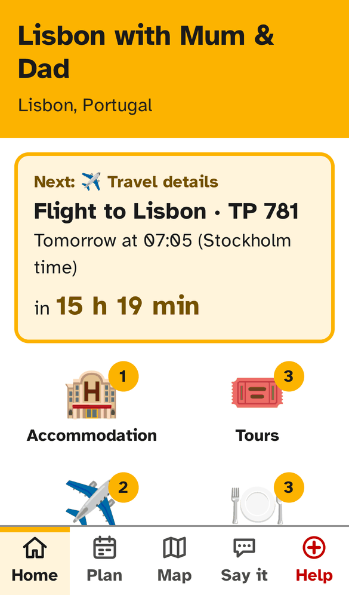
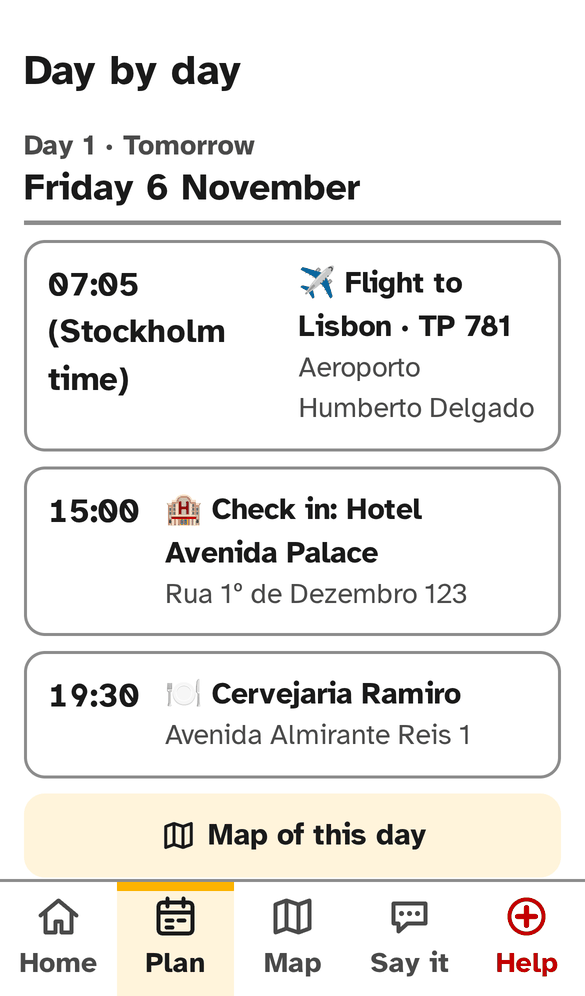
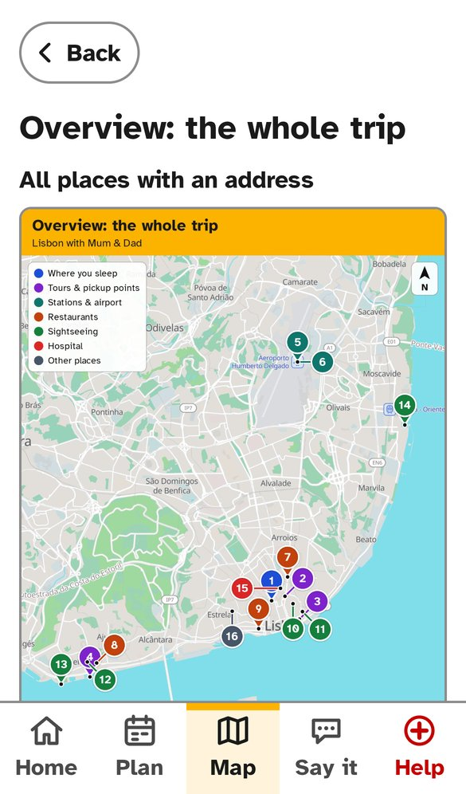
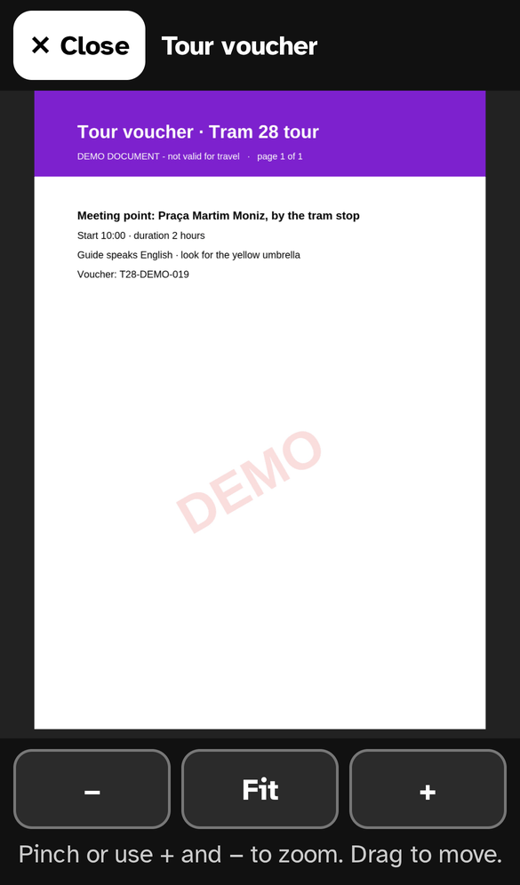
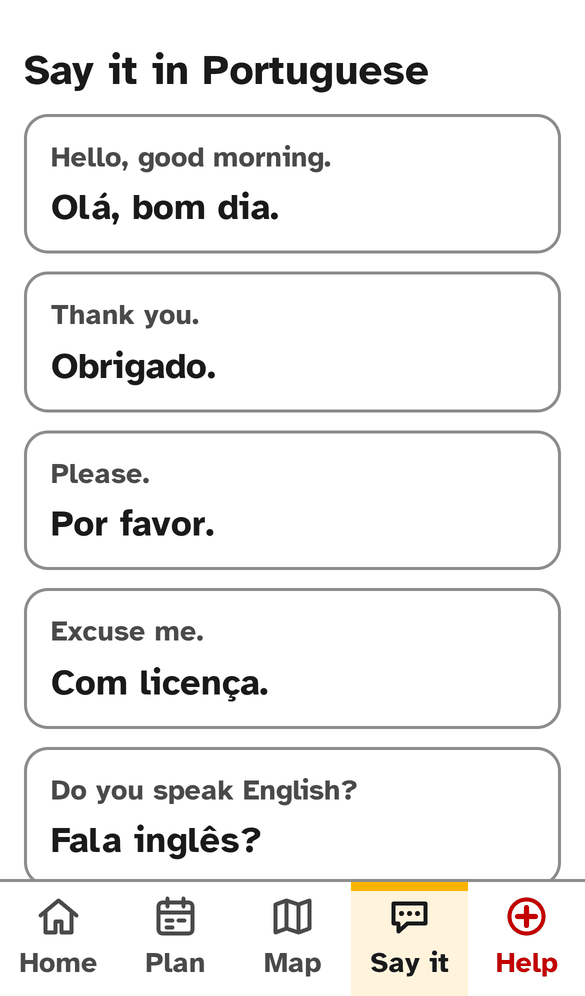
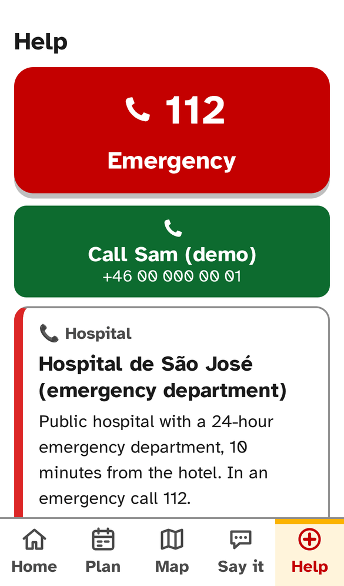
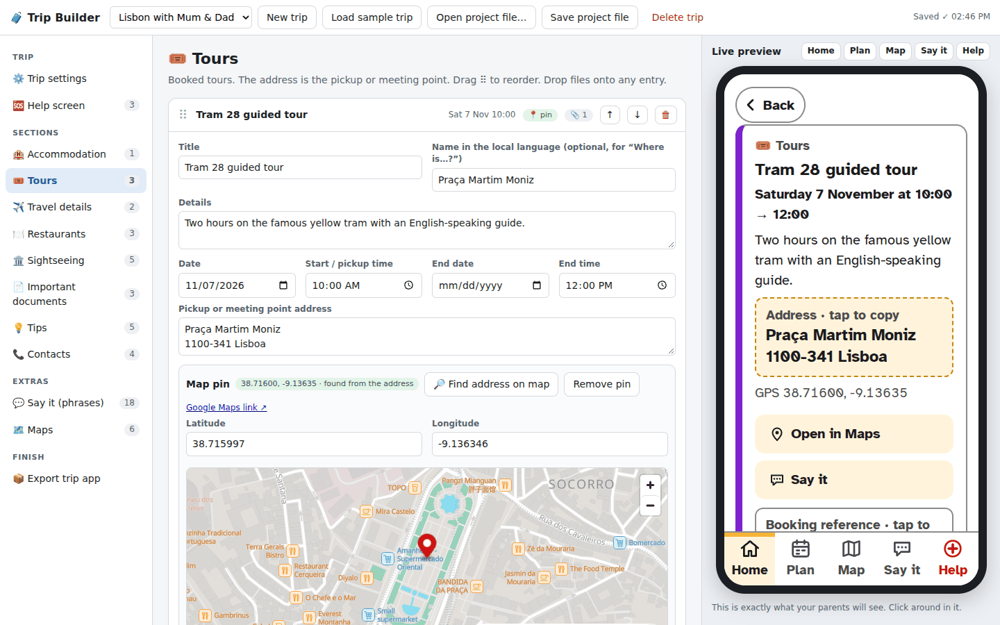

# 🧳 Trip Companion

**Build a simple, fully offline travel app for your parents' phones, from your laptop.**

You fill in the trip in the **Trip Builder**, a small web app that runs on your own computer.
One click on **Export** turns it into a large-print phone app with the bookings, tickets, maps,
phrases and emergency numbers, all working without internet. There's no backend, no accounts and
no tracking: the export is a folder of static files you can host for free.

This app was originally designed to assist aging parents in navigating solo overseas travel. 
I have kept the parents' metaphor throughout, but of course, you can be your own parent and use it for your own travels!

<p align="center">
  
  
  
  
  
  
</p>

## Features

**For your parents (the phone app)**

- 🔠 Large text, high contrast, five big buttons: **Home · Plan · Map · Say it · Help**
- ⏱️ Countdown to the next booking, and reminders 15 minutes before
- 📄 Tickets and documents open full screen and zoom, so **QR codes can be scanned from the phone**
- 🗺️ Annotated offline maps for the whole trip and for each day, plus an optional moving map with GPS
- 💬 **Say it**: phrases in the local language, shown big and spoken aloud, plus "Please take me to…" cards for taxis
- 🆘 **Help**: one-tap emergency number, "Call me" and your own Help cards (hospital, insurance, ski patrol…)
- ✈️ Works in Airplane mode, and updates itself the next time it's online

**For you (the Trip Builder)**

- 🖥️ Runs locally with one command, using Python only, with nothing to install
- 📱 A live phone preview that shows exactly what your parents will see
- 📎 Drag and drop PDFs and photos, which are compressed automatically
- 📍 Addresses are turned into map pins automatically, and you can drag a pin to correct it
- 🌍 Phrases are translated on your laptop (Chrome or Edge), with nothing sent anywhere
- ✅ A check before export: missing addresses, phone numbers, translations, and an app over 50 MB

<p align="center">
  
</p>

## Contents

- [Quick start](#quick-start)
- [Make a trip](#make-a-trip)
- [Export](#export)
- [Host it for free](#host-it-for-free)
- [Install on the phones](#install-on-the-phones)
- [Updating the trip](#updating-the-trip)
- [The single-file backup](#the-single-file-backup)
- [Testing](#testing)
- [Limits and good to know](#limits-and-good-to-know)
- [Project structure](#project-structure)
- [Credits and licences](#credits-and-licences)

Also in this repository:

- [PARENTS-HOW-TO-USE.md](PARENTS-HOW-TO-USE.md): the one-page sheet for your parents. Every
  export also writes a printable copy with your link and phone number filled in.
- [ARCHITECTURE.md](ARCHITECTURE.md): how it's built.

## Quick start

**Requirements:** Python 3.9 or newer, and Chrome, Edge or Firefox. macOS and Linux come with
Python; on Windows, install it from [python.org](https://www.python.org/downloads/).

```bash
git clone https://github.com/<your-username>/trip-companion.git
cd trip-companion
python3 start.py          # Windows: py start.py
```

Your browser opens at <http://localhost:8765>. Leave the terminal window open while you work, and
press <kbd>Ctrl</kbd>+<kbd>C</kbd> in it to stop.

> [!TIP]
> To see a finished trip right away, click **Load sample trip**. It's a 5-day Lisbon trip that
> starts tomorrow, with demo tickets, maps and phrases. Then go to **Export trip app → Export**
> and click **Try the app here**.

## Make a trip

Everything saves automatically to `projects/<trip>/`. To keep a copy or move a trip to another
computer, use **Save project file** (a `.zip`) and later **Open project file…**.

### Trip settings

Trip name, home-screen name, destination, **time zone**, icon (emoji or letters) and colour. The
default colour is amber `#FCB300`, and the whole app palette is built from it (see
[Colours](#limits-and-good-to-know)).

### Help screen

- The local **emergency number** (the big red button), and **your name and phone** (the green
  button).
- **+ Add emergency service** is for numbers like ski patrol, mountain rescue or coast guard.
  These appear right under the emergency button, with a red call button.
- **+ Add other Help card** is for anything else.
- Hospital, embassy, insurance and pharmacy contacts are on Help automatically. Any contact can be
  put on or taken off Help with the **Show on the Help screen** tick box.
- Order: emergency services first, then the others in Contacts order (↑ ↓).

### Sections and entries

The sections are Accommodation, Tours, Travel details, Restaurants, Sightseeing, Important
documents, Tips and Contacts.

- **+ Add** makes an entry, and clicking an entry opens it. Drag ⠿ or use ↑ ↓ to reorder, and 🗑
  to delete.
- **Fields:** title, details, date and time (plus end date and time), address, map pin, phone,
  booking reference, notes and documents. The Google Maps link is made from the address.
- In *Contacts*, set the **role** (Hospital, Embassy, Travel insurance, Emergency service…).

Day numbers in the plan follow the calendar. Days without bookings are shown as
"Nothing booked".

### Documents

- Drag PDF, JPG or PNG files onto any entry, several at once.
- Photos over 600 kB or 2000 px are shrunk automatically. PNG screenshots stay PNG, so QR codes
  remain sharp.
- Each PDF page becomes a sharp picture, 2000 px wide (about 240 dpi on A4). It opens full screen
  on the phone, offline, so **ticket QR codes can be scanned straight from the screen**. The
  original PDF file itself is not put in the app.
- You can rename or remove a file under its thumbnail.

### Map pins

When you type an address, the pin is looked up automatically (OpenStreetMap Nominatim, one
address per second). To correct it, drag the pin, click the map, or type the latitude and
longitude.

### Say it (phrases)

1. Type the **language** and its **speech code** (e.g. `pt-PT`, `el-GR`). Pick it from the list or
   type any code.
2. **Pick phrases** from about 40 suggestions grouped by situation. ★ marks the most useful, and
   **Add all ★ phrases** adds those 14.
3. **Translations are made automatically** in Chrome or Edge on a computer. This happens on the
   laptop itself, with no account, and nothing is sent anywhere. It covers ticked suggestions,
   your own English phrases (type, then <kbd>Enter</kbd> or <kbd>Tab</kbd>) and the two place
   phrases.
4. The place phrases "Please take me to this address:" and "Where is {place}?" appear behind the
   **Say it** button on every event with an address. **Play** says the whole phrase plus the
   address.

> [!WARNING]
> Machine translations are shaded in the Builder: check them, especially health and allergy
> phrases. Editing a translation keeps your wording, and ↻ translates again.

- In other browsers, or for a language the browser can't translate, type the translations
  yourself. Phrases without a translation are left out of the app, and the export check lists
  them.
- If "Please take me to…" is left empty, the card shows English and speaks only the address. If
  "Where is…?" is empty, it is left out.
- ▶ in the Builder uses the laptop's best voice for the language. Phones usually sound better.

### Maps

1. **Find pins for all addresses**
2. **Download map area**: a [Protomaps](https://protomaps.com) extract of the destination,
   typically 5–20 MB
3. **Draw maps**: an overview map plus one map per day
4. Optional: switch on the **moving map** (pan, zoom and a GPS dot, offline)

## Export

Go to **Export trip app**. The Builder first **checks** the trip: missing addresses or pins, a
time without a date, no hospital or insurance, a Help card without a phone number, an unusual
phone number, a total size over 50 MB, and so on. Each problem has a **Fix** link.

Then click **Export trip app**. It draws any maps that are out of date and writes:

```text
exports/<trip>/
├── site/                     ← the app: upload this folder
├── <trip>-site.zip           ← the same, zipped
├── <trip>-offline.html       ← single-file backup (everything inside)
└── How-to-use-<trip>.html    ← one-page sheet for your parents (print or save as PDF)
```

**Try the app here** opens the exported app from your laptop, offline cache included.

## Host it for free

The app has to be on an `https://` address for "Add to Home Screen" and offline mode to work.

<details open>
<summary><b>Netlify</b> (easiest)</summary>

1. Make a free account at <https://app.netlify.com/signup>. If you drop a folder without an
   account, Netlify deletes the site after one hour unless you claim it.
2. Go to <https://app.netlify.com/drop> and drag the **`site`** folder onto the page.
3. In *Project configuration → Change project name*, pick a name that is hard to guess, e.g.
   `lisbon-mum-dad-7k3q`. Your link becomes `https://lisbon-mum-dad-7k3q.netlify.app`.
4. If the project is marked private (new teams default to that), choose **Make public**.
5. Optional: paste the link into **Trip settings → After hosting** and export again, so it's
   printed on the parents' sheet.

**To update:** open the same project in Netlify → **Deploys** → drag the new `site` folder onto
the drop area. The link stays the same.

</details>

<details>
<summary><b>GitHub Pages</b></summary>

1. Create a new **repository** for the trip. Don't use this code repository for it. On a free
   account it must be **public**, so give it an unguessable name.
2. Click **Add file → Upload files** and drag in the **contents** of the `site` folder (not the
   folder itself), then click **Commit changes**.
3. Go to **Settings → Pages**, set *Source* to **Deploy from a branch**, branch **main**, folder
   **/ (root)**, and click **Save**.
4. After a minute or two the link appears at the top of that page:
   `https://<your-name>.github.io/<repo-name>/`.

**To update:** upload the new files the same way (they replace the old ones) and commit. GitHub
Pages caches files for up to 10 minutes, so give it a moment.

</details>

> [!IMPORTANT]
> **Privacy.** Anyone who has the link can open the app, and everything in it, including passport
> copies. Use an unguessable name, don't post the link publicly, and consider leaving out the most
> sensitive scans. The app tells search engines not to index it (`robots.txt`, `noindex`), and
> nothing is sent anywhere from the phone.

## Install on the phones

Do this **at home on Wi-Fi**, ideally with your parents. Each phone needs to open the app once
online.

| | iPhone (Safari) | Android (Chrome) |
|---|---|---|
| 1 | Open the link in **Safari** | Open the link in **Chrome** |
| 2 | **Share** (□↑) → **Add to Home Screen** → **Add** | **⋮** → **Add to Home screen** (or **Install app**) |
| 3 | **Open the new icon** and wait for **"✓ Ready for offline"** | Open the new icon and wait for **"✓ Ready for offline"** |
| 4 | Test it in Airplane mode | Test it in Airplane mode |

> [!NOTE]
> On iPhone, the home-screen app has its own storage, separate from Safari. That's why step 3,
> opening it from the icon while online, is needed.

**Reminders.** On the Home screen, tap **Allow reminders** (the card then disappears). A reminder
pops up 15 minutes before every booking that has a time, but **only while the app is open**:
neither phone lets a website wake itself up in the background. On iPhone, system notifications
need iOS 16.4+ and the app opened from the home screen. The in-app pop-up works everywhere.

## Updating the trip

Change anything in the Builder → **Export** again → upload the new `site` folder to the same place
(see "To update" above). Re-exports always go to the same folder, even if you rename the trip.

The next time your parents open the app **with internet**, it downloads the new version in the
background, reloads and shows **"✓ Your trip was updated"**. Until then they keep the old version,
which still works offline.

## The single-file backup

`<trip>-offline.html` contains everything (documents, page pictures and maps) for when hosting
isn't possible. Send it by e-mail or messenger, or AirDrop it.

- **Android:** open it from *Files/Downloads* in Chrome. It runs as the full app (countdown, Say it
  with Play, zoom viewer), but without automatic updates.
- **iPhone:** iOS shows local HTML files in a preview (Quick Look) that **does not run
  JavaScript**. The file is therefore built to work without it: the whole trip appears as one long,
  large-print page with a table of contents, tap-to-call links, documents, maps and phrases.
  There's no countdown, no Play button and no pinch viewer (normal pinch-zoom works). On iPhone,
  the hosted link is the better option and the file is the fallback.
- The moving map is not included in the single file, to keep it small.

## Testing

### Automated

`tests/e2e_test.py` loads the sample trip, draws the maps, switches on the moving map, exports,
then opens the app in **iPhone 13** and **Pixel 7** emulation. It checks:

- the offline cache, and use in Airplane mode
- the document viewer, with PDF pages at full resolution
- the place phrases behind "Say it", and the phrases
- the moving map with the GPS dot
- the emergency button
- the minimum text size
- the update after a re-export
- the single file, with and without JavaScript

```bash
pip install playwright && python -m playwright install chromium
python3 start.py --no-browser &
python3 tests/e2e_test.py
```

### On real phones

Emulation uses Chrome's engine, so it can't prove Safari behaviour. **Before you send the link,
spend five minutes on a real iPhone and Android phone:**

- [ ] Add to Home Screen, open from the icon, see "Ready for offline".
- [ ] In Airplane mode: open the app, a PDF, a photo and a map, and check that pinch-zoom works.
- [ ] Say it → a phrase → **Play** speaks in the right language.
- [ ] Help → the red button opens the dialler with 112 (don't call).
- [ ] Tap an address → "Copied"; paste it in a note.
- [ ] Re-export with a small change, upload, open the app online → "Your trip was updated".

<details>
<summary>Play is silent?</summary>

Check that the ring/silent switch is off and the volume is up. If there's no voice for the
language, add one under *Settings → Accessibility → Spoken Content → Voices* (iPhone) or
*Text-to-speech* (Android).

</details>

## Limits and good to know

| Topic | Details |
|---|---|
| **Size** | The Builder warns above 50 MB. The Lisbon sample is about 4 MB, or about 18 MB with the moving map. |
| **Map data** | © OpenStreetMap contributors (ODbL), via the [Protomaps](https://protomaps.com) daily basemap build, which is meant for downloading extracts and using them offline. The public OpenStreetMap tile servers are **not** used. The attribution is printed on every map. Map labels use the local language, as on street signs. Label fonts cover Latin, Greek and Cyrillic; other scripts are downloaded on demand while you draw maps. |
| **Geocoding** | Each address is sent once to OpenStreetMap Nominatim (max one per second, cached in `projects/.geocache.json`). Always check the pin. |
| **Time zones** | Times are entered in destination time. For the flight out, set the entry's time zone to your home time zone. The countdown and reminders then work even if the phone is still on home time. |
| **"Open in Maps"** | Needs internet. Every address is also shown as plain text with its GPS coordinates, and *Map → All addresses* is a plain list that always works. |
| **Colours** | The app is white with one accent colour (default amber `#FCB300`). `TripRender.palette()` in `app-template/render.js` builds the palette so it stays readable: the accent is used only as a fill, text on it is near-black (9.6:1 for amber), amber-toned text is darkened to `#745200` (7.1:1 on white), and dark mode uses `#121212`/`#1E1E1E` with amber accents. Any other colour you pick gets the same treatment. Map pin colours are fixed per category, so the maps stay consistent. |

## Project structure

```text
trip-companion/
├── start.py          local server, using the Python standard library only
├── builder/          Trip Builder UI
├── app-template/     the parents' app (PWA)
├── vendor/           map and PDF libraries
├── sample/           demo trip (make_sample.py)
├── tests/            end-to-end test
├── docs/screenshots/ images for this README
├── projects/         your trips (not committed, see .gitignore)
├── exports/          export output (not committed)
└── tools/            pmtiles command-line tool (downloaded automatically, not committed)
```

> [!CAUTION]
> `projects/` and `exports/` contain your trips, including scans of passports and tickets. They
> are listed in `.gitignore`, so keep them out of any public repository.

## Credits and licences

- **Font:** [Atkinson Hyperlegible](https://www.brailleinstitute.org/freefont/), SIL Open Font
  License (see `app-template/fonts/OFL.txt`).
- **Libraries in `vendor/`:** [MapLibre GL JS](https://maplibre.org) (BSD-3),
  [pmtiles](https://github.com/protomaps/PMTiles) (BSD-3),
  [@protomaps/basemaps](https://github.com/protomaps/basemaps) (BSD-3),
  [pdf.js](https://mozilla.github.io/pdf.js/) (Apache-2.0, Builder only).
- **Map data:** © [OpenStreetMap](https://www.openstreetmap.org/copyright) contributors, ODbL.
